# Obsidian and Tokyonight

A tokyonight theme for [Obsidian](https://obsidian.md). Colors from [tokyonight.nvim](https://github.com/folke/tokyonight.nvim) and [VSCode Tokyonight](https://github.com/enkia/tokyo-night-vscode-theme). To change colors please install [Style Settings](https://github.com/mgmeyers/obsidian-style-settings)

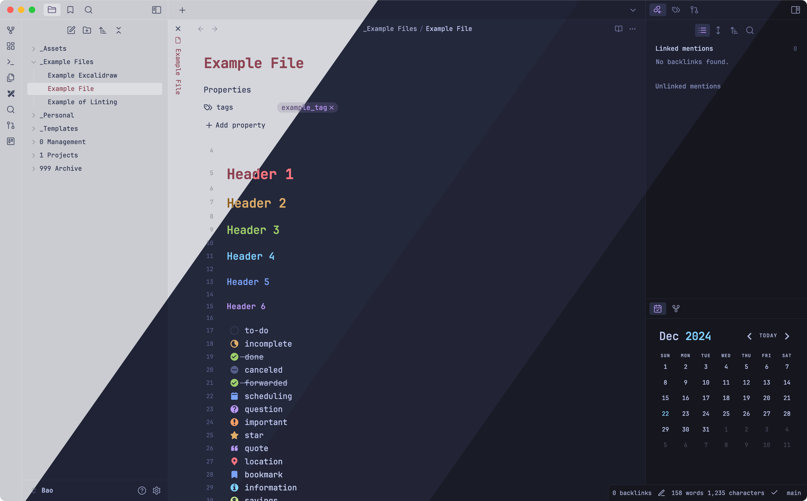

## Table of Content

- [Versions](#versions)
- [Checkbox Styling](#checkbox-styling)
- [Installation](#installation)

## Versions

Import the styles into Style Settings for Storm and Moon. Both the Night and Light themes are the default.

### Light

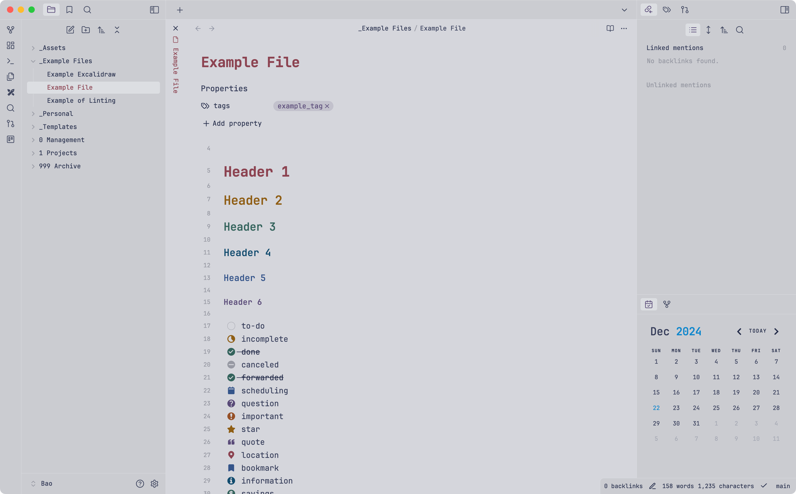

### Storm

[Storm Style Settings Configuration](./variants/tokyonight-storm.json)

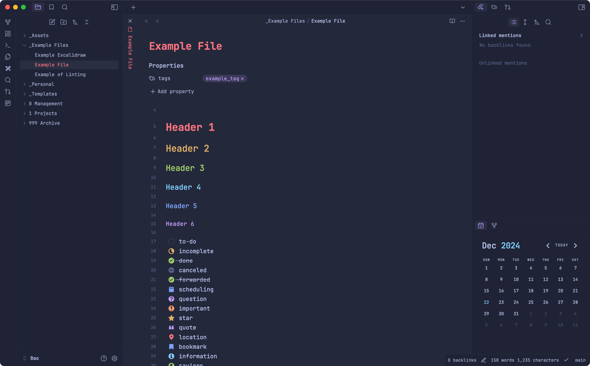

### Moon

[Moon Style Setting Configuration](./variants/tokyonight-moon.json)

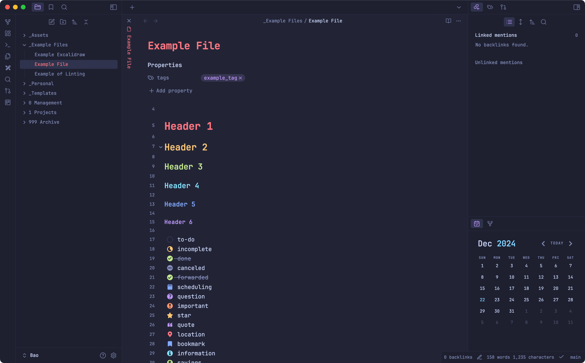

### Night

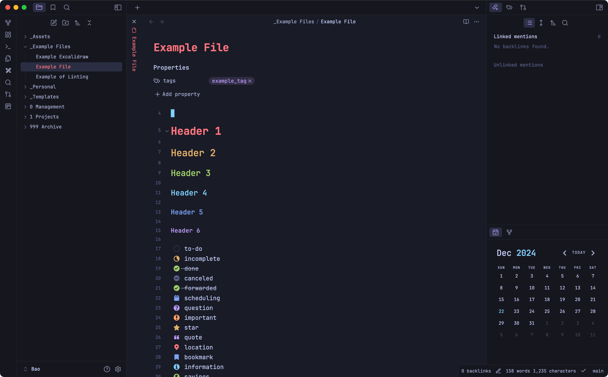

## Checkbox Styling 

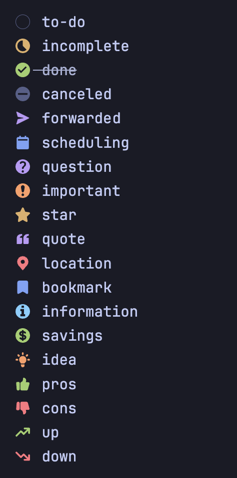

```
- [ ] to-do
- [/] incomplete
- [x] done
- [-] canceled
- [x] forwarded
- [<] scheduling
- [?] question
- [!] important
- [*] star
- ["] quote
- [l] location
- [b] bookmark
- [i] information
- [S] savings
- [I] idea
- [p] pros
- [c] cons
- [u] up
- [d] down
```

## Installation

### Base theme installation
Installing the base theme can be completed in the Obsidian settings.

1. Open the Obsidian **Settings** menu.

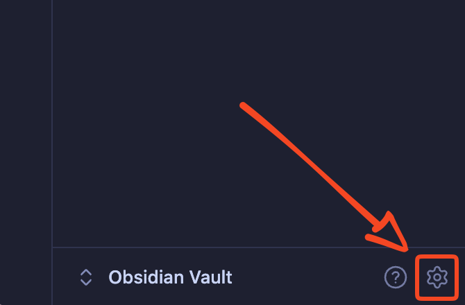

2. Click **Appearance** in the left sidebar.
3. Find **Themes** and click **Manage**, this opens the theme search.

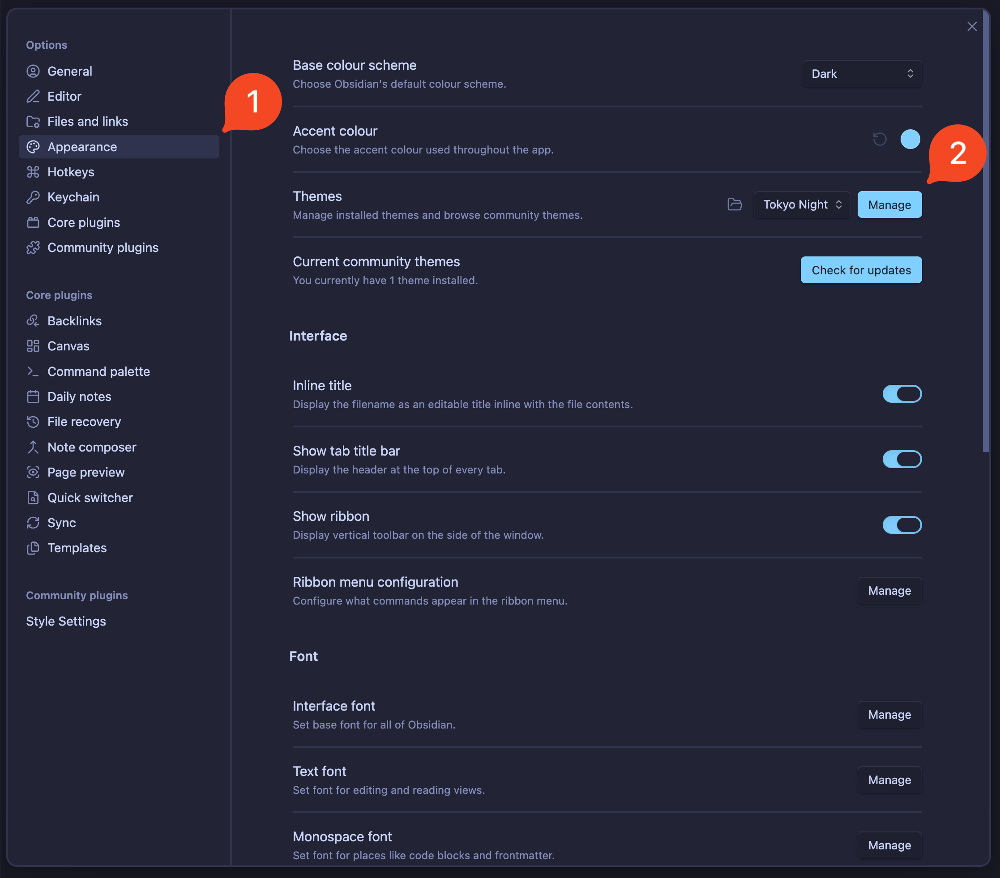

4. Search for the Tokyo Night theme by **tcmmichaelb139**.
    - There are other themes with similar names so make sure to check the user.

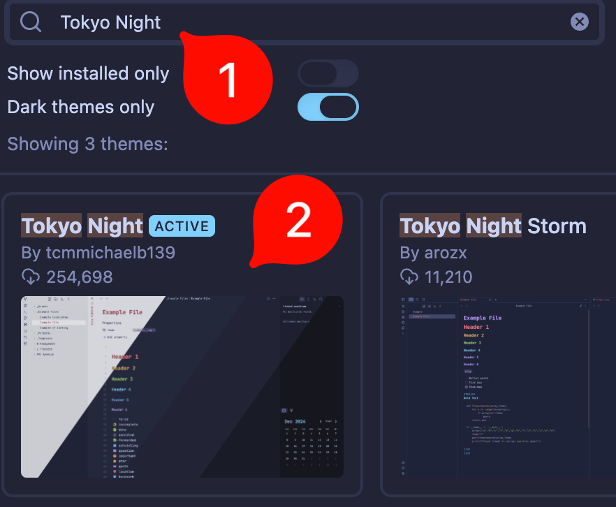

5. Click **Install and use** to start using the base theme.

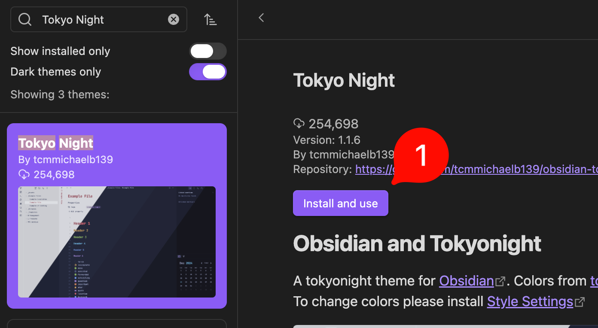

### Variant theme installation
Installation of the variant themes requires the [Style Settings](https://github.com/mgmeyers/obsidian-style-settings) **Community plugin** in order to work. Please install this before completing the below steps.

#### Download configuration
You can download the configuration to import into **Style Settings** using the following steps.

1. Open the [variant directory](./variants) for the **Obsidian Tokyo Night** theme.
2. Select the variant option JSON file and click the name.
3. Above the JSON text on the right side, click the **Download raw file** button. Save the file in an accessible location.

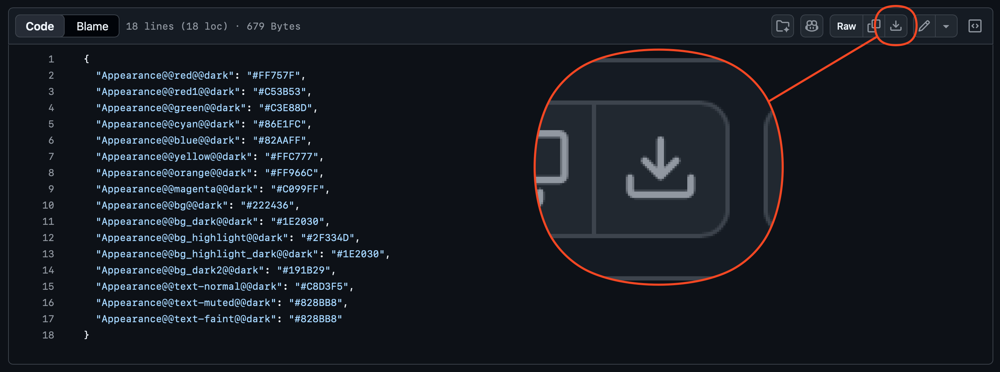


#### Copy configuration to clipboard
If you would prefer not to download the file you can instead copy the JSON string to your clipboard for use in the **Style Settings** plugin.

1. Open the [variant directory](./variants) for the **Obsidian Tokyo Night** theme.
2. Select the variant option JSON file and click the name.
3. Above the JSON text on the right side, click the **Copy raw file** button. Make sure not to overwrite your system clipboard before entering the data into Obsidian.

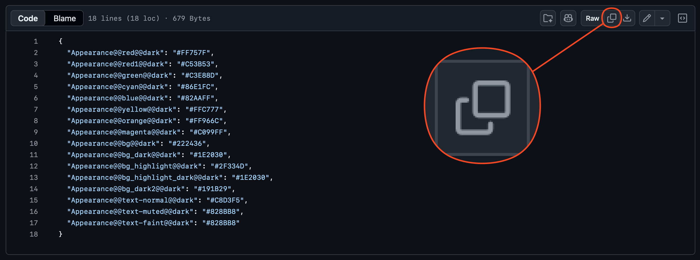


#### Installation in Obsidian
Once you have obtained the variation configuration JSON you can complete the configuration update in **Style Settings**

1. Open the Obsidian **Settings** menu.


2. Under the **Community plugins** section in the settings sidebar, click **Style Settings**. This opens the **Style Settings** configuration pane.

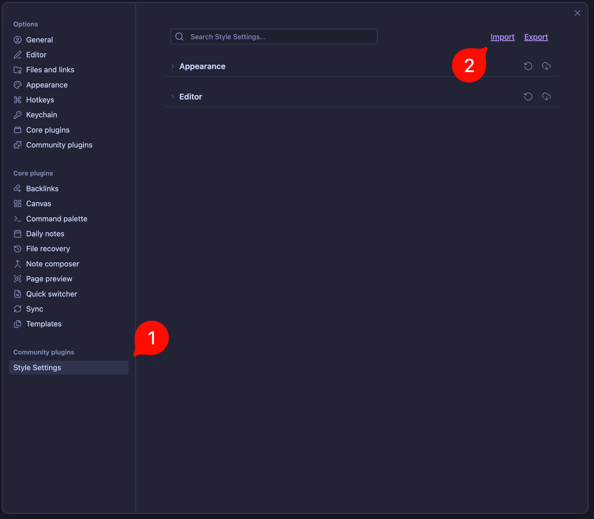

3. In the top right corner click **Import**, this opens the import dialog.

Depending on how you gathered the variant configuration the next steps differ.

##### Downloaded configuration
1. Click **Import from file**, this opens the file dialog.
2. Select the file from the save location.
3. Click **Open**.

##### Copied configuration
1. Paste the copied configuration into the text field **Paste config here...**
2. Click **Save**.

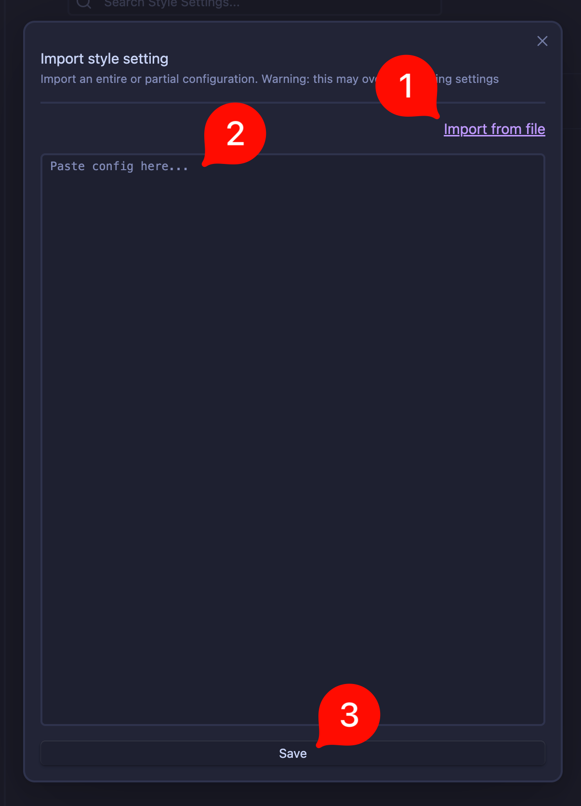

In both instances the configuration should be reflected in Obsidian almost immediately


## Credit 

- [tokyonight.nvim](https://github.com/folke/tokyonight.nvim) and [VSCode Tokyonight](https://github.com/enkia/tokyo-night-vscode-theme) for the wonderful theme colors.
- [Obsidian Border](https://github.com/Akifyss/obsidian-border/tree/main) for some amazing styles. 

